# LGTM.md

**Looks good to ReadMe.** Animated pixel-art widgets for your GitHub profile README, drawn every night from your real activity.

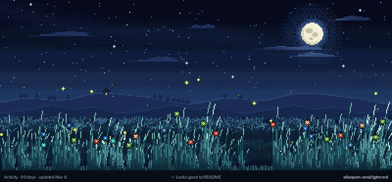

A GitHub Action collects your contributions, languages and merged pull requests, then draws each widget as a GIF and commits it to your profile repository. One prebuilt binary, no server, no third-party service: your data never leaves GitHub.

Every widget answers one question in two seconds. The animation is there to show the number, not to decorate it.

## Get started

Go to **[lgtm.byelior.dev](https://lgtm.byelior.dev)**, pick your widgets and type your login. The site writes the workflow and the README lines for you, and walks you through the token step.

<details>
<summary><b>Install by hand</b></summary>

### Profile README

You need a [profile repository](https://docs.github.com/en/account-and-profile/setting-up-and-managing-your-github-profile/customizing-your-profile/managing-your-profile-readme): a public repository named after your login (`<login>/<login>`).

**1. Add the workflow.** In your profile repository, create `.github/workflows/lgtm-md.yml`:

```yaml
name: LGTM.md

on:
  schedule:
    - cron: "30 0 * * *"   # every night, just after midnight UTC
  workflow_dispatch:
  push:
    paths: [.github/workflows/lgtm-md.yml]   # also runs as soon as you commit this file

permissions:
  contents: write

concurrency: lgtm-md

jobs:
  draw:
    runs-on: ubuntu-latest
    steps:
      - uses: actions/checkout@v4
      - uses: eliorpom-cmd/lgtm.md@v1.2.0
        with:
          token: ${{ secrets.LGTM_MD_TOKEN || github.token }}
          widgets: |
            flame
            grass
            records
      - name: Commit the widgets if they changed
        run: |
          git add widgets
          git diff --cached --quiet && exit 0
          git config user.name "github-actions[bot]"
          git config user.email "41898282+github-actions[bot]@users.noreply.github.com"
          git commit -m "widgets: draw the day's widgets"
          git push
```

Committing the file starts the workflow right away. About a minute later, the GIFs are in the `widgets/` folder.

**2. Show them in your README.** Paste one line per widget:

```html
<a href="https://github.com/eliorpom-cmd/lgtm.md"></a>
```

The GIFs are drawn at twice their display size so they stay sharp on high-density screens, so always set a `width`: `100%` for the wide widgets, about `50%` for `flame` and `counter`, which sit well side by side.

The image links back here so visitors can find the project. A small credit line under your widgets helps too:

```html
<sub>Made with <a href="https://github.com/eliorpom-cmd/lgtm.md">LGTM.md</a></sub>
```

From then on, the widgets redraw themselves every night. To redraw them now, open the **Actions** tab, pick **LGTM.md**, then **Run workflow**.

### Count your private activity (optional)

With the default token, the widgets only see public activity. To count your work in private repositories too, give the Action a read-only token:

1. Open this pre-filled link: [create a fine-grained token](https://github.com/settings/personal-access-tokens/new?name=LGTM.md&description=Read-only+token+for+LGTM.md&expires_in=none&contents=read&pull_requests=read). It asks for **Contents** and **Pull requests**, both read-only, and no expiration, so the widgets never stop updating.
2. Under **Repository access**, choose **All repositories**. The link cannot set this one for you.
3. Click **Generate token** and copy it.
4. In your profile repository, go to **Settings → Secrets and variables → Actions → New repository secret**. Name it `LGTM_MD_TOKEN` and paste the token.

The workflow above already uses `LGTM_MD_TOKEN` when it exists. The token can only read: it cannot push, open issues or change settings.

One limit comes from GitHub: a fine-grained token covers the repositories of a single owner, so pull requests in **another organization's private repositories** are not counted. Everything else is: private commits, private repositories' languages and their history.

The link sets no expiration, so the widgets keep updating without you renewing anything. If you prefer an expiry date, pick one on the form: GitHub emails you before the token expires, then create a new one and replace the secret.

### Project README

The same widgets can draw a repository instead of an account: its commits, merged pull requests, languages and stars. Set the `repo` input, and publish the GIFs on a separate branch: a nightly commit on the default branch would count as activity, and the streak would never end.

**1. Add the workflow.** In your project repository, create `.github/workflows/lgtm-md.yml` from [`examples/repo-workflow.yml`](examples/repo-workflow.yml). It draws the widgets every night and replaces a single commit on a `lgtm-md` branch, so that branch never grows. The default token is enough, private repository included: no secret to set. GitHub pauses scheduled workflows in a public repository after 60 days without activity; if your widgets stop updating, turn the workflow back on in the **Actions** tab.

**2. Show them in your README**, from that branch (replace `<owner>/<repo>`):

```html
<a href="https://github.com/eliorpom-cmd/lgtm.md">/<repo>/raw/lgtm-md/grass.gif" alt="Commits of the last 90 days" width="100%"></a>
```

Widgets available for a repository: `flame`, `counter`, `hourglass`, `ecg`, `departures`, `donut`, `grass`, `cherry-tree`, `forest`, `fireworks`, `fireworks-commits`, `records`. `median` and the duels compare accounts, so they are refused in this mode.

What gets counted for a repository:

- **Commits** are the commits on the default branch, all authors, merges included, by commit date (UTC). They replace contributions on every widget. Counting them takes a few seconds for most repositories, about two minutes for the very largest (the Linux kernel).
- **Pull requests** are the ones merged into the repository.
- **Stars** are the repository's total, on the `departures` board in place of the streak. GitHub no longer lists who starred a repository or when, so there is no daily star count.
- **Languages** are the repository's own, weighted by size. Commits take the repository's main language, as they do in account mode, so `hourglass` and `fireworks-commits` show a single colour.

</details>

## Widgets

List the ones you want in the `widgets` input, one per line. Leave the input out to draw all of them except the duels.

| Widget | In one line |
| --- | --- |
| [`flame`](#flame) | Your current streak of active days. |
| [`counter`](#counter) | Contributions over the last 12 months. |
| [`hourglass`](#hourglass) | Commits of the past year, as sand coloured by language. |
| [`ecg`](#ecg) | The last 7 days as a heartbeat. |
| [`departures`](#departures) | A station board cycling through four stats. |
| [`donut`](#donut) | Your top languages. |
| [`grass`](#grass) | The last 90 days, one tuft of grass per day. |
| [`cherry-tree`](#cherry-tree) | The last 90 days, one blossom cluster per day. |
| [`forest`](#forest) | The last 12 months, one tree per week. |
| [`fireworks`](#fireworks) | Pull requests merged in the last 7 days. |
| [`fireworks-commits`](#fireworks-commits) | Commits of the last 7 days. |
| [`records`](#records) | Best day, longest streak, longest break. |
| [`median`](#median) | You against the accounts you follow. |
| [`duel-<login>`](#duel-login) | You against one friend. |

Every GIF has a thin band underneath that says what it shows and when it was last updated. The examples below use made-up data.

### `flame`

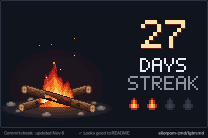

- **The number** is your current streak: days in a row with at least one contribution, up to yesterday.
- **The fire** grows in four steps: a small fire under 7 days, medium from 7, large from 30, and a blue heart from 100. The pips under the number show which step you reached.
- **No streak** leaves cold logs, a few dying embers and a thread of smoke.

### `counter`

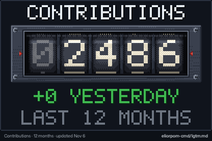

- **The drums** show your contributions over the last 12 months. They roll from the day before's total up to today's, like a car's odometer.
- **"+N yesterday"** is what yesterday added.

### `hourglass`

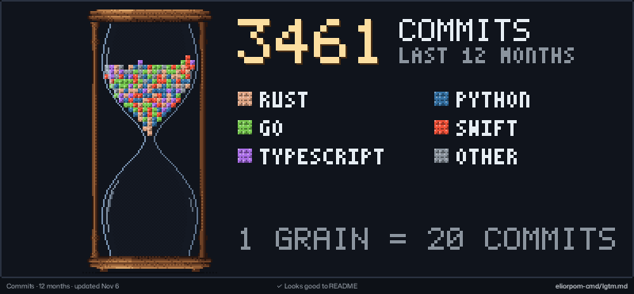

- **Each grain** is a batch of commits from the past year; the line at the bottom says how many (1 grain = 20 commits here).
- **The colour** of a grain is the language of the repository the commits went to. The legend lists them, most used first.
- **The sand falls in order**, oldest first, so the layers of the pile read like the year: bottom is a year ago, top is this month.
- On your profile the hourglass plays once and the pile stays. It loops here so you can watch it again.

### `ecg`

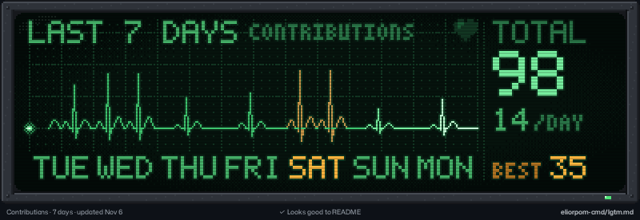

- **One heartbeat per day** over the last 7 days, oldest on the left: a single beat for a quiet day, two beats for a busy one, a flat line for a day without contributions.
- **The highest beat** is your best day of the week, highlighted in amber with its day name.
- **On the right**: the week's total, the daily average and the best day's count.

### `departures`

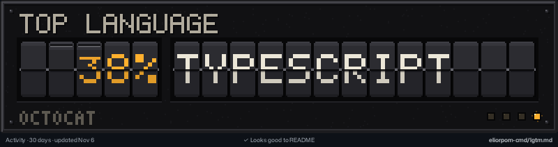

- **A station board** whose flaps turn over every few seconds to show four stats in turn: contributions over 12 months, pull requests merged in 30 days, current streak, and top language.

### `donut`

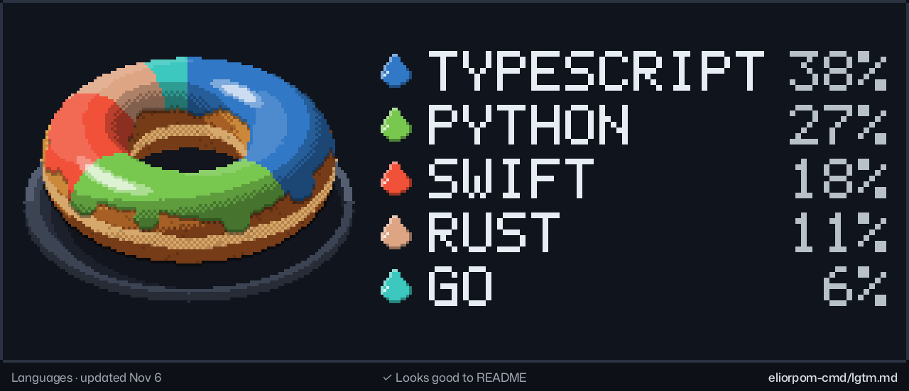

- **Each slice of icing** is a language, sized by its share of the code in your repositories. The five largest are named, the rest is vanilla "Other".
- **Colours** are GitHub's language colours. When two look alike (Python and TypeScript are both blue), the less used one gets a colour you can tell apart.
- Markup (HTML, CSS, MDX, notebooks…) is left out, so the doughnut shows the languages you program in.

### `grass`


- **One tuft per day** over the last 90 days, oldest on the left, yesterday on the right. The busier the day, the taller the tuft; a day off leaves bare ground.
- **Flowers** are your languages, in proportion: more flowers of a colour means more code in that language.
- **Fireflies** are the pull requests merged in the last 30 days, one each.

### `cherry-tree`

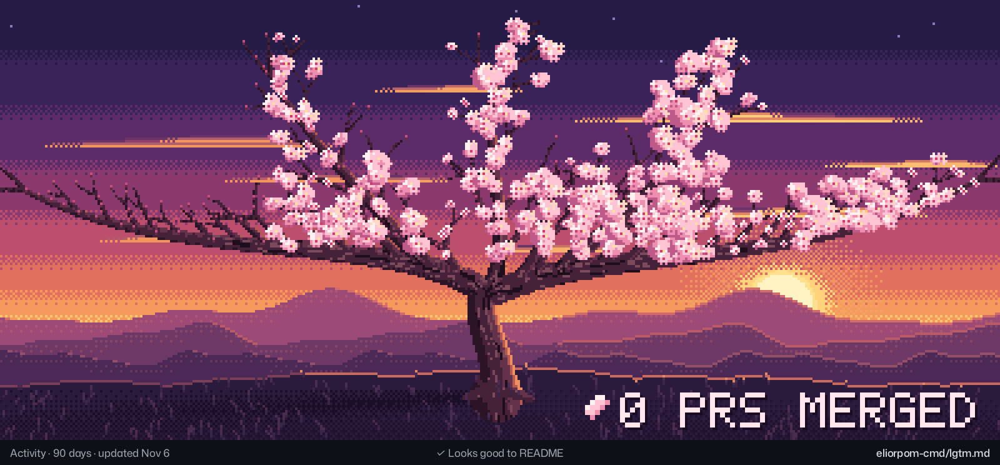

- **The crown** is cut into 90 slices, one per day, oldest on the left. A slice blossoms when you contributed that day and stays bare when you didn't.
- **Each falling petal** is a pull request merged in the last 30 days; the count is in the corner.

### `forest`

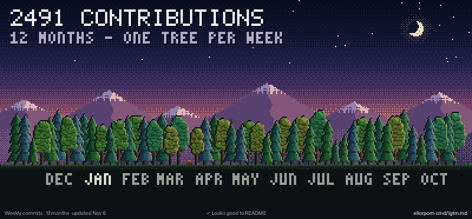

- **One tree per week** over the last 12 months, oldest on the left, months marked underneath.
- **The height and width of a tree** follow that week's contributions: a sapling for a quiet week, a tall wide tree for a busy one.
- **An empty week** leaves a stump. **A pause of several weeks** becomes a clearing where a deer grazes.

### `fireworks`

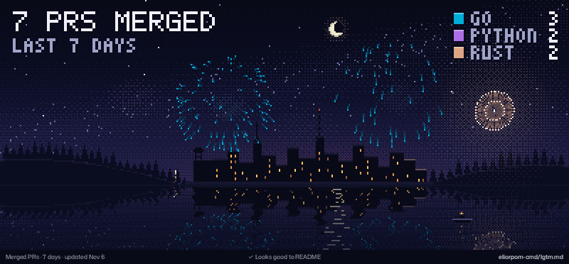

- **One rocket per pull request** merged in the last 7 days, launched in the order they were merged.
- **The colour of a burst** is the main language of the pull request's repository; the legend counts them.

### `fireworks-commits`

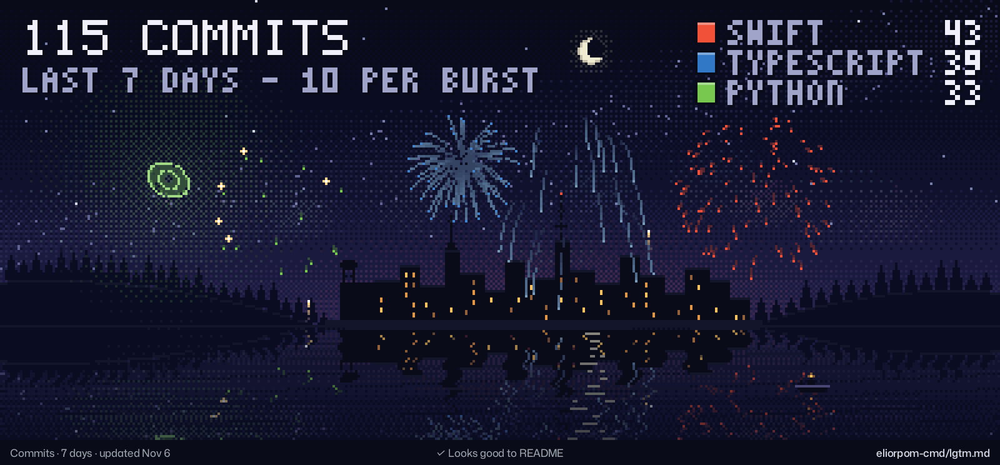

- **One rocket per batch of commits** of the last 7 days; the subtitle says how many commits a full burst stands for. A smaller burst is a batch that isn't full.
- **The colour** is the language of the repository; the legend gives the commits per language.

### `records`

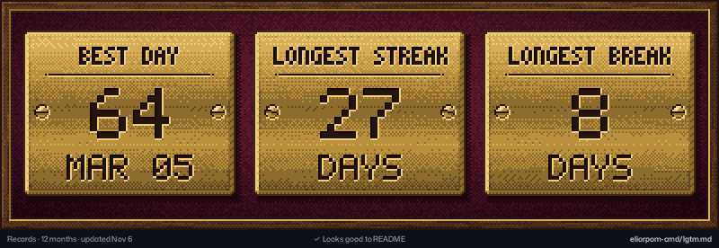

- **Best day**: your most contributions in a single day over the last 12 months, with its date.
- **Longest streak**: the most days in a row with at least one contribution.
- **Longest break**: the most days in a row without any.

### `median`

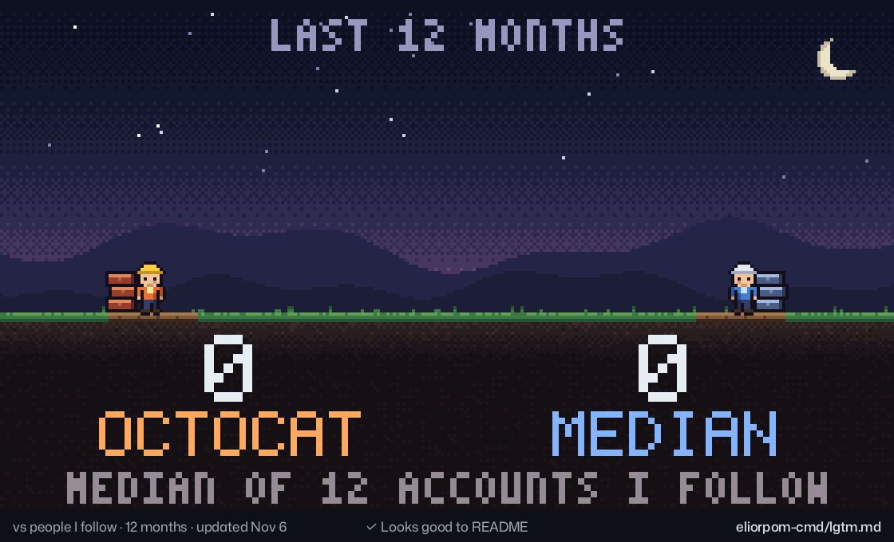

- **Two builders** raise brick towers: yours on the left with your contributions over 12 months, the other with the median of the accounts you follow.
- **The median** is the middle account: half of the people you follow contributed more, half less. A dashed line carries its height across to your tower so you can compare.

### `duel-<login>`

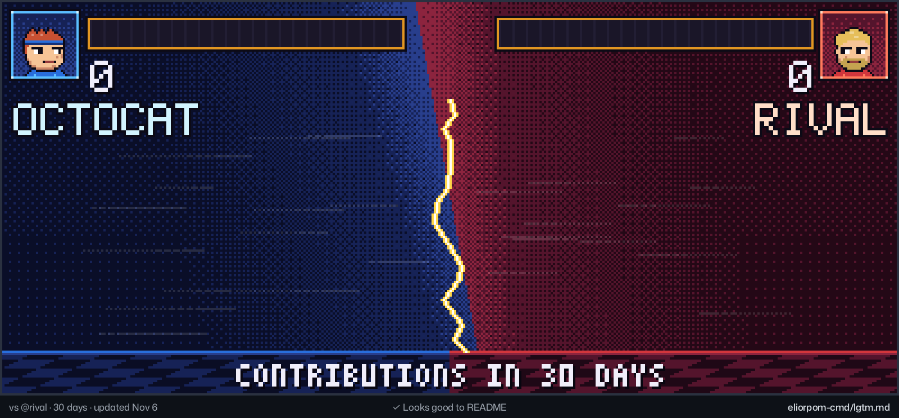

- **You on the left in blue, your friend on the right in red**, with your avatars.
- **Each pillar** is one day (one week for the 12-month duel), both sides on the same scale. The power bars at the top fill up to each total, and the winner is crowned.
- Write `duel-torvalds` for 30 days, `duel-torvalds-7` for a week, `duel-torvalds-365` for a year. For a login that itself ends in `-7` or `-365`, add the period: `duel-<login>-30`. Your friend's side only uses public data.

## Action inputs

| Input | Default | What it does |
| --- | --- | --- |
| `token` | `github.token` | Token used to read your activity. See [private activity](#count-your-private-activity-optional). |
| `user` | the repository owner | GitHub login to draw. |
| `repo` | empty | A repository written `owner/name`: draws it instead of an account (see [project README](#project-readme)). |
| `widgets` | every widget except duels | Widget names, separated by spaces or new lines. |
| `output-dir` | `widgets` | Folder where the GIFs are written. |

Pin a release tag such as `@v1.2.0` rather than a branch: a moving reference runs whatever code it points to, with your token.

## Run it on your computer

```sh
cargo build --release
./target/release/lgtm-md collect <login> data.json      # reads your activity with `gh auth token` or GITHUB_TOKEN
./target/release/lgtm-md collect --repo <owner/name> data.json   # or a repository's activity
./target/release/lgtm-md data.json flame grass --out widgets
```

Without widget names, every widget except the duels is drawn. Add `--stills` for a still PNG of each widget, `--help` for the full list of options. `examples/data.json` holds sample data for a made-up account, so you can try the drawing without a token.

## What gets counted

- **Contributions** are the numbers of your GitHub contribution graph: commits, pull requests, issues and reviews, private ones included with a token.
- **Commits by language** come from the history of the repositories you own, plus your contributions to other people's repositories. A commit takes the main language of its repository.
- **Languages** are the languages of your repositories, weighted by size. Markup (HTML, CSS, MDX, notebooks…) is left out of the doughnut and the flowers.
- **Days** follow UTC, like GitHub's contribution graph.

## Support

LGTM.md is free and MIT-licensed. If you like it, you can [buy me a coffee on Ko-fi](https://ko-fi.com/eliorpom).

## License

[MIT](LICENSE)
